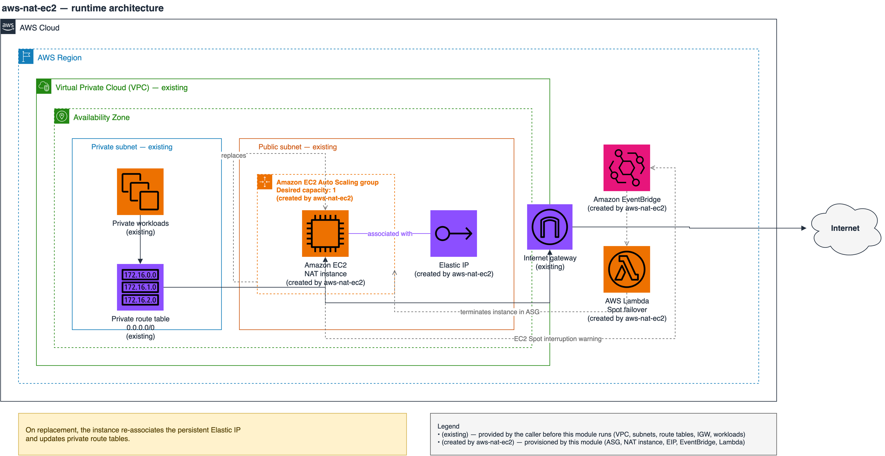

# aws-nat-ec2

A Spot-capable AL2023 NAT instance — a cheaper alternative to AWS Managed
NAT Gateway for outbound-only internet access from private subnets. One
module call provisions one NAT instance (via an Auto Scaling Group) and
one persistent Elastic IP in a single Availability Zone. Call the module
once per AZ that needs NAT egress.

- AL2023 via the public SSM AMI parameter — no custom AMI.
- Spot by default, with reactive ASG replacement and proactive failover
  (Spot interruption warning → Lambda).
- Spot exhaustion fallback: CloudWatch alarm + Lambda flips the ASG to
  On-Demand when zero instances stay InService.
- Optional SNS notifications (bring-your-own topic) for failover and
  Lambda error/throttle alarms.
- Persistent public IP across instance replacements.
- SSM Session Manager only — no SSH, no key pairs, no bastion.

Inputs and outputs are below. See [SPEC.md](docs/SPEC.md) for design,
IAM permissions, and a manual verification plan.

## Architecture



Editable source: [`docs/architecture.drawio`](docs/architecture.drawio)
(open in [diagrams.net](https://app.diagrams.net) or the draw.io VS
Code/desktop app).

## Requirements

| Name | Version |
|---|---|
| terraform | >= 1.9 |
| aws provider | ~> 6.0 |
| archive provider | ~> 2.4 |

This module has no `provider` block — the caller's root module /
Terragrunt config supplies AWS credentials and region.

## Usage (Terragrunt)

The module does not create VPC/subnet/route-table topology. It consumes
an existing public subnet (for the NAT instance) and existing private
route table(s) to repoint at it:

```hcl
terraform {
  source = "git::https://github.com/hostmaster/aws-nat-ec2.git?ref=v0.1.12"
}

dependency "vpc" {
  config_path = "../vpc"
}

dependency "subnets" {
  config_path = "../subnets"
}

inputs = {
  # Unique per module call / AZ — Lambda, log group, and alarm names
  # use this value directly (no Terraform random suffix).
  name_prefix             = "myapp-dev-a"
  vpc_id                  = dependency.vpc.outputs.vpc_id
  public_subnet_id        = dependency.subnets.outputs.public_subnet_ids[0]
  private_route_table_ids = [dependency.subnets.outputs.private_route_table_ids[0]]

  architecture = "x86_64" # or "arm64"
  use_spot     = true
  tags = {
    environment = "dev"
  }
}
```

For a second AZ, add another Terragrunt unit with that AZ's subnet /
route tables and a **distinct `name_prefix`** (e.g. `myapp-dev-b`).
Lambda, log group, and alarm names are derived from `name_prefix` with
no extra uniqueness, so shared prefixes collide.

## Inputs

Required: `name_prefix`, `vpc_id`, `public_subnet_id`,
`private_route_table_ids`. Everything else has a default.

| Variable | Type | Default | Description |
|---|---|---|---|
| `name_prefix` | `string` | — (required) | Prefix for resource names and tags. Max 20 characters (validated) — longer values can exceed AWS's 64-character limit once module suffixes and Terraform's random `name_prefix` suffix are added. **Must be unique per module call** (e.g. per AZ): Lambda, log group, and alarm names use it directly with no added uniqueness. |
| `vpc_id` | `string` | — (required) | Existing VPC ID. |
| `public_subnet_id` | `string` | — (required) | Existing public subnet for the NAT instance. AZ is derived from this subnet. |
| `private_route_table_ids` | `list(string)` | — (required) | Route table IDs to repoint at the active NAT instance. |
| `architecture` | `string` | `"x86_64"` | `"x86_64"` or `"arm64"`. Selects the AMI SSM parameter and default instance types. |
| `instance_types` | `list(string)` | arch-based default (e.g. `["t3a.nano","t3.nano"]` or `["t4g.nano"]`) | Candidate instance types for the ASG mixed-instances policy. |
| `root_volume_size` | `number` | `8` | Root EBS volume size (GB), 8–100 (validated). |
| `root_volume_kms_key_id` | `optional(string)` | `null` | Optional customer-managed KMS key for root volume encryption. If `null`, the account default `aws/ebs` key is used. **Customer-managed keys must authorize `AWSServiceRoleForAutoScaling`** — the ASG creates the volume, and that service-linked role has no access to CMKs by default. Add two statements for principal `arn:aws:iam::<account-id>:role/aws-service-role/autoscaling.amazonaws.com/AWSServiceRoleForAutoScaling`: one allowing `kms:Encrypt`, `kms:Decrypt`, `kms:ReEncrypt*`, `kms:GenerateDataKey*`, `kms:DescribeKey`; another allowing `kms:CreateGrant` with `kms:GrantIsForAWSResource: true`. See [AWS key policy requirements](https://docs.aws.amazon.com/autoscaling/ec2/userguide/key-policy-requirements-EBS-encryption.html). |
| `use_spot` | `bool` | `true` | Prefer Spot capacity. |
| `spot_on_demand_fallback` | `bool` | `true` | When `use_spot` is true, flip to 100% On-Demand via alarm + Lambda if zero instances stay InService. Ignored when `use_spot` is false. |
| `spot_fallback_alarm_period_seconds` | `number` | `120` | CloudWatch alarm period for Spot-exhaustion fallback. |
| `spot_fallback_alarm_evaluation_periods` | `number` | `2` | Consecutive breaching periods before fallback runs. |
| `eip_allocation_id` | `optional(string)` | `null` | Bring-your-own EIP allocation ID. If `null`, the module allocates a new EIP. |
| `release_eip_on_destroy` | `bool` | `true` | **Documentation-only — no Terraform effect.** `lifecycle` cannot reference variables, so `terraform destroy` always releases a module-allocated EIP. To keep the EIP, run `terraform state rm '<module address>.aws_eip.nat[0]'` before destroy. Ignored when `eip_allocation_id` is set. |
| `allow_inbound_cidrs` | `list(string)` | `[]` | Extra ingress CIDRs on the NAT security group (beyond VPC CIDR ingress). |
| `tags` | `map(string)` | `{}` | Extra tags on all resources. |
| `sns_topic_arn` | `optional(string)` | `null` | Bring-your-own SNS topic for failover/health notifications. If `null`, no SNS resources are created. |
| `sns_topic_kms_key_arn` | `optional(string)` | `null` | CMK ARN encrypting `sns_topic_arn`, if any. Grants the failover Lambda `kms:GenerateDataKey*`/`kms:Decrypt`. **IAM alone is not enough** — the key policy must also allow this Lambda role (or keep the default account-root `kms:*` delegation). **Does not cover** Spot-fallback / backstop alarms or the ASG notification: those need key-policy statements for `cloudwatch.amazonaws.com` and `AWSServiceRoleForAutoScaling`. Those service publishes also **cannot use `alias/aws/sns`**; they require a customer-managed key. See [SNS KMS](https://docs.aws.amazon.com/sns/latest/dg/sns-key-management.html), [KMS key policies](https://docs.aws.amazon.com/kms/latest/developerguide/key-policies.html), and [ASG SNS KMS](https://docs.aws.amazon.com/autoscaling/ec2/userguide/ASGettingNotifications.html#sns-kms-permissions). Ignored if `sns_topic_arn` is unset (validated). |
| `log_retention_days` | `number` | `14` | Retention (days) for both Lambdas' CloudWatch log groups. Must be a CloudWatch Logs `retention_in_days` value (validated). |

## Outputs

| Output | Description |
|---|---|
| `nat_instance_asg_name` | Auto Scaling Group name. |
| `nat_instance_security_group_id` | Security group ID on the NAT instance. |
| `eip_public_ip` | Persistent public IP. |
| `eip_allocation_id` | EIP allocation ID (module-created or BYO). |
| `iam_role_arn` | NAT instance IAM role ARN. |
| `failover_lambda_arn` | Proactive-failover Lambda ARN. |
| `eventbridge_rule_arn` | Spot-interruption EventBridge rule ARN. |
| `spot_fallback_lambda_arn` | Spot-exhaustion fallback Lambda ARN (`null` when disabled). |
| `spot_fallback_alarm_arn` | Spot-exhaustion CloudWatch alarm ARN (`null` when disabled). |

## Day-2 ops: after Spot-exhaustion fallback

When Spot capacity is exhausted, the fallback Lambda flips the **live**
ASG Mixed Instances Policy to 100% On-Demand. Terraform state and config
still say Spot (`use_spot = true`) until you change them.

**Do this next (deliberate apply):**

1. Confirm egress recovered (private instance can reach the internet;
   ASG has an InService instance).
2. Set `use_spot = false` in the Terragrunt/module inputs and apply.
   That aligns config with the live On-Demand policy so a later apply
   does not fight the Lambda.
3. Optionally turn off `spot_on_demand_fallback` while staying On-Demand
   (it is ignored when `use_spot = false`, but keeping inputs honest
   avoids confusion).

**Do not** run a blind `terraform apply` / `terragrunt apply` while
`use_spot = true` after a fallback. That resets the ASG to Spot-only and
can recreate the same outage if Spot is still exhausted.

**Returning to Spot later:** only when Spot capacity has recovered —
set `use_spot = true` (and re-enable fallback if desired) and apply as a
planned change, not as an incidental config sync.

## Inspiration

- [int128/terraform-aws-nat-instance](https://github.com/int128/terraform-aws-nat-instance) (archived)
- [AndrewGuenther/fck-nat](https://github.com/AndrewGuenther/fck-nat)
